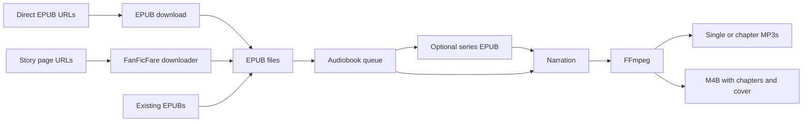

# FanFic to Audio

`StrixMCS Labs · Dr. Matt Booth`

[](https://github.com/strixmcs-labs/fanfic-to-audio/actions/workflows/ci.yml)
[](LICENSE)

Download fanfiction as EPUB, then turn it into an audiobook in one native Mac app. FanFic to Audio combines a SwiftUI interface, the [FanFicFare](https://github.com/JimmXinu/FanFicFare) download engine, and local or AI narration.

**Powered by FanFicFare**, by **Jim Miller (JimmXinu) and the FanFicFare contributors**. FanFicFare provides the story download engine and site adapters used by this app.

**[Download the macOS app](https://github.com/strixmcs-labs/fanfic-to-audio/releases/latest)** · **[Installation guide](docs/installation.md)** · **[User guide](docs/usage.md)**

The packaged app requires **Apple silicon and macOS 14 or later**. Python and FanFicFare are included. A standalone FFmpeg encoder with MP3 and AAC support is included, so no separate FFmpeg installation is needed. Check the selected release notes for its signing and notarization status; see the installation guide before opening it.

Version 1.5 adds custom chapter order and titles, author's-note skipping, read-aloud titles, a pronunciation list, faster AI narration, completion notifications, and dark mode. Version 1.4 added automatic story/direct-EPUB link downloading, hands every completed download to the saved audiobook queue, bundles the audio encoder, and added white backgrounds with oxblood accents. Version 1.3 introduced a saved, resumable audiobook queue, per-book settings, AI usage budgets, and M4B chapter navigation with cover art. Developer builds support Developer ID signing (including a YubiKey) and Apple notarization.

## What it does

- Download story pages or direct EPUB links, preview story metadata, find story links, and update existing FanFicFare books with backups.
- Add several EPUBs at once, reorder the audiobook queue, pause it, and retry unsuccessful jobs.
- Follow the selected or active queue item in the open-book preview.
- Combine separate EPUBs into an ordered series without changing the originals.
- Narrate with macOS voices, OpenAI, ElevenLabs, or OpenRouter. Provider keys are saved explicitly in macOS Keychain.
- Export one MP3 per book, numbered chapter MP3s, or an M4B with chapter navigation and cover art.
- Reuse a bounded EPUB cache and avoid redundant intermediate MP3 encoding steps.



## Get started

1. Install the app following the [installation guide](docs/installation.md).
2. Paste a story page or direct EPUB URL in **Download by Link**, select a destination, then click **Download & Prepare Audiobook**. Or open an existing EPUB with **Open EPUB…** / Command-O.
3. Review the sections, select a speech provider and voice, and create an audiobook.
4. For a batch, use **Add EPUBs…**, arrange the queue, then **Create Queued Audiobooks…**. To make one series, select waiting EPUBs, enter its title, and **Combine Selected EPUBs…** first.

AI previews and exports send book text to the selected provider and may incur API charges. Local macOS narration and audio encoding run on your Mac. The audiobook queue and compatible completed passages survive app restarts. Read the [privacy documentation](PRIVACY.md) for stored settings, credentials, and network behavior.

## Documentation

| Guide | Covers |
| --- | --- |
| [Installation](docs/installation.md) | Release download, FFmpeg, voices, macOS security approval |
| [User guide](docs/usage.md) | Downloads, bulk queues, series merging, AI narration |
| [Troubleshooting](docs/troubleshooting.md) | Site errors, voices, API failures, unsupported EPUBs |
| [Development](docs/development.md) | Dependencies, tests, packaging, command-line tool |
| [Architecture](docs/architecture.md) | Modules, publication protocol, caching, export flow |
| [Validation](VALIDATION.md) | Verified behavior and remaining test limits |
| [Changelog](CHANGELOG.md) | Release history |
| [Contributing](CONTRIBUTING.md) | Changes, tests, useful bug reports |
| [Privacy](PRIVACY.md) / [Security](SECURITY.md) | Data handling and private vulnerability reports |
| [Publisher Privacy Policy](https://github.com/strixmcs-labs/policies/blob/main/PRIVACY-POLICY.md) / [Terms of Service](https://github.com/strixmcs-labs/policies/blob/main/TERMS-OF-SERVICE.md) | Dr. Matt Booth's project and support policies |

## Build from source

Use a Swift 6 toolchain, Apple's Command Line Tools or Xcode, Python 3.12, and FFmpeg:

```sh
python3.12 -m venv .venv
.venv/bin/python -m pip install -r requirements-build.txt
./Scripts/swift.sh test
PYTHONPATH="$PWD/Vendor" .venv/bin/python -m pytest -q Tests/DownloadEngineTests
./Scripts/build-app.sh
```

The app is written to `dist/FanFic to Audio.app`. See [development instructions](docs/development.md) for a clean-clone walkthrough, smoke validation, and release packaging. The supplied release is Apple silicon; an Intel app bundle has not been validated.

## Limits

Only unprotected EPUBs with readable text are supported. There is no OCR or embedded MP3 chapter navigation; use M4B or chapter files for navigation. The download list is restored after relaunch, but interrupted downloads must be started again. Site support and authentication depend on FanFicFare; interactive login and browser challenges are not handled by this interface.

## Credits and license

Thank you to **Jim Miller (JimmXinu) and all FanFicFare contributors** for [FanFicFare](https://github.com/JimmXinu/FanFicFare). Its engine powers story downloads, website adapters, metadata previews, EPUB creation and updates, and story-link extraction. See the [FanFicFare documentation](https://github.com/JimmXinu/FanFicFare/wiki) and [upstream license](https://github.com/JimmXinu/FanFicFare/blob/main/LICENSE).

FanFic to Audio is an independent application and is not an official FanFicFare release. This project's native interface and integration are licensed under [Apache 2.0](LICENSE). The bundled FanFicFare Python engine is also licensed under Apache 2.0; its separately distributed Calibre plugin is GPLv3 and is not bundled here.

The app also includes downloader interface modules from FanFicFare Desktop and EPUB narration components from the EPUB to MP3 project. FanFicFare and other dependencies retain their original copyright and license notices, which ship inside the app. The bundled standalone FFmpeg/LAME encoder includes its source archives and license notices; Qt is not bundled. See [NOTICE](NOTICE).

---

*Scientia · Societas · Ascensus*  
Knowledge · Society · Ascent  
[mattbooth.me](https://mattbooth.me) · `StrixMCS Labs · Dr. Matt Booth`
